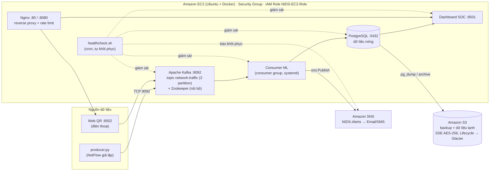

# AWS NIDS: Hệ thống phát hiện xâm nhập mạng thời gian thực bằng Machine Learning và Apache Kafka trên AWS

Bài tập lớn môn **Điện toán đám mây**, Nhóm 07, Nhóm môn học 02, Học viện Công nghệ Bưu chính Viễn thông.

Hệ thống nhận bản ghi NetFlow qua **Apache Kafka (cổng 9092)**, phân loại bằng mô hình Học máy (Normal / DDoS / Port Scan / Brute Force), lưu kết quả vào **PostgreSQL**, hiển thị trên **Dashboard SOC (Streamlit)**, gửi cảnh báo qua **Amazon SNS**, và sao lưu/lưu trữ lạnh lên **Amazon S3**. Toàn bộ chạy bằng Docker trên **Amazon EC2**, xác thực AWS bằng **IAM Role** (không có Access Key trong mã nguồn).

> **Cổng Kafka:** mặc định **9092**, cấu hình bằng biến `KAFKA_PORT` trong `.env`. Muốn chạy cổng khác (ví dụ 9091 khi giảng viên kiểm tra) chỉ cần đặt `KAFKA_PORT=9091` trong `.env` rồi chạy lại `bash start_nids.sh`, không phải sửa code.

## 1. Kiến trúc



| Thành phần | Công nghệ | Vai trò |
|---|---|---|
| Sinh dữ liệu | `producer.py`, `tv3/qr_attack_app.py` | Giả lập lưu lượng sạch / DDoS / Port Scan / Brute Force |
| Message broker | Apache Kafka 7.5 (Confluent) + Zookeeper | Bộ đệm, tách rời producer và consumer, 3 partition để chia tải |
| Xử lý lõi | `tv3/consumer_tv3.py` (hoặc `consumer_ids.py`) | Chuẩn hóa + dự đoán bằng `nids_model.joblib`, ghi DB, gửi SNS |
| Lưu trữ nóng | PostgreSQL 15 | Bảng `nids_events` (khóa chống ghi trùng theo offset Kafka) |
| Lưu trữ lạnh / sao lưu | Amazon S3 | `scripts/backup_postgres_s3.sh`, `scripts/archive_events_s3.py` |
| Giám sát | Streamlit `tv3/dashboard.py` | Dashboard SOC cập nhật 3 giây/lần |
| Cảnh báo | Amazon SNS | Email/SMS khi có tấn công (cooldown 30 giây/loại) |
| Điều phối lưu lượng | Kafka partition + consumer group, Nginx | Chia tải xử lý, một cổng web, giới hạn tốc độ |
| Khôi phục | Docker `restart`, healthcheck, systemd, `scripts/healthcheck.sh` | Tự khởi động lại, tự khôi phục, báo SNS |

## 2. Cấu trúc thư mục

```text
├── docker-compose.yml          # Zookeeper + Kafka (:9092) + PostgreSQL, healthcheck, restart, volume
├── .env.example                # Mẫu cấu hình (copy thành .env, không commit)
├── start_nids.sh               # Khởi động trên EC2: lấy IP Public, ghi .env, chạy Docker, tạo topic
├── run_demo.sh                 # Menu demo 3 kịch bản (Normal / DDoS / DDoS + Port Scan)
├── producer.py                 # Sinh NetFlow, điều khiển kịch bản qua topic nids-control
├── consumer_ids.py             # Consumer bản đầu: in nhãn + SNS
├── train_model.py              # Huấn luyện mô hình → nids_model.joblib, scaler.joblib
├── benchmark.py                # Đo throughput / latency Kafka và ML (kết quả trong benchmark_results/)
├── test_sns.py, test_sns_role.py  # Kiểm tra gửi SNS bằng IAM Role
├── tv3/                        # Dashboard SOC, Web QR, Consumer ghi PostgreSQL
├── scripts/
│   ├── backup_postgres_s3.sh   # Sao lưu PostgreSQL → S3 (mã hóa SSE, kiểm tra toàn vẹn)
│   ├── restore_postgres_s3.sh  # Khôi phục PostgreSQL từ S3
│   ├── archive_events_s3.py    # Chuyển dữ liệu cũ (lạnh) sang S3 dạng JSONL.gz
│   ├── healthcheck.sh          # Kiểm tra sức khỏe, --recover để tự khôi phục
│   └── install_services.sh     # Cài consumer/dashboard/QR thành dịch vụ systemd
├── deploy/
│   ├── iam/nids-ec2-policy.json   # Chính sách IAM đặc quyền tối thiểu cho NIDS-EC2-Role
│   ├── iam/s3-bucket-policy.json  # Bắt buộc HTTPS + mã hóa khi ghi S3
│   ├── iam/s3-lifecycle.json      # Chuyển Glacier / tự xóa bản sao lưu cũ
│   ├── nginx/nids.conf            # Reverse proxy + rate limit
│   └── systemd/*.service          # Dịch vụ tự khởi động lại
└── docs/
    ├── HUONG_DAN_TRIEN_KHAI_AWS.md  # Các bước làm trên AWS Console / EC2
    ├── RUNBOOK_KHOI_PHUC.md         # Quy trình khôi phục dịch vụ (RTO/RPO, sự cố thường gặp)
    └── BAO_CAO_BO_SUNG.md           # Nội dung bổ sung cho báo cáo theo đề thi
```

## 3. Security Group (Inbound)

| Cổng | Giao thức | Nguồn khuyến nghị | Mục đích |
|---|---|---|---|
| 22 | TCP | IP của nhóm (`x.x.x.x/32`) | SSH quản trị bằng khóa `.pem` |
| **9092** | TCP | IP các máy Producer | Kafka nhận NetFlow (= `KAFKA_PORT`, mặc định 9092) |
| 8501 | TCP | `0.0.0.0/0` khi demo, hoặc đóng nếu dùng Nginx | Dashboard SOC |
| 8502 | TCP | `0.0.0.0/0` khi demo (điện thoại quét QR) | Web QR |
| 80 / 8080 | TCP | `0.0.0.0/0` (tùy chọn) | Nginx cho Dashboard / Web QR |
| 5432 | TCP | **Không mở**, hoặc chỉ IP thành viên | PostgreSQL (mặc định chỉ nghe 127.0.0.1) |

Outbound để mặc định (cần HTTPS 443 để gọi SNS/S3). Zookeeper 2181 không còn mở ra ngoài.

## 4. Chạy trên máy cá nhân (test nhanh)

```bash
cp .env.example .env               # sửa POSTGRES_PASSWORD
docker compose up -d --wait
python -m venv .venv && source .venv/bin/activate
pip install -r tv3/requirements.tv3.txt

# Terminal 1: Consumer ghi PostgreSQL
cd tv3 && NIDS_KAFKA=localhost:9092 NIDS_DSN=postgresql://nids_user:<mật_khẩu>@localhost:5432/nids_db python -u consumer_tv3.py
# Terminal 2: Producer
KAFKA_BOOTSTRAP_SERVERS=localhost:9092 python producer.py
# Terminal 3: Dashboard
cd tv3 && NIDS_DSN=... streamlit run dashboard.py --server.port 8501
```

## 5. Triển khai trên EC2

```bash
git clone https://github.com/quynh112-ptit/AWS-NIDS-Project.git && cd AWS-NIDS-Project
cp .env.example .env && nano .env      # mật khẩu Postgres, BACKUP_S3_BUCKET
bash start_nids.sh                      # tự ghi IP Public vào .env, Kafka :9092
python3 -m venv .venv && .venv/bin/pip install -r tv3/requirements.tv3.txt
sudo bash scripts/install_services.sh   # consumer + dashboard + QR chạy dạng systemd
bash run_demo.sh                        # menu demo
```

Chi tiết các bước trên AWS Console (IAM Role, S3, SNS, Security Group, CloudWatch, Snapshot EBS): xem [docs/HUONG_DAN_TRIEN_KHAI_AWS.md](docs/HUONG_DAN_TRIEN_KHAI_AWS.md).

## 6. Sao lưu và khôi phục

| Dữ liệu | Cách sao lưu | Tần suất | Nơi lưu |
|---|---|---|---|
| PostgreSQL (`nids_events`) | `scripts/backup_postgres_s3.sh` (pg_dump + gzip + SSE-S3) | 6 giờ/lần (cron) | `s3://<bucket>/postgres/` |
| Dữ liệu cũ hơn 24h | `scripts/archive_events_s3.py --delete` | Hằng ngày | `s3://<bucket>/events/dt=YYYY-MM-DD/` |
| Dữ liệu thô chưa xử lý | Kafka giữ 24h (`KAFKA_LOG_RETENTION_HOURS`) | Liên tục | Volume `kafka_data` |
| Toàn bộ ổ EC2 | EBS Snapshot (Amazon Data Lifecycle Manager) | Hằng ngày | AWS |
| Mã nguồn, mô hình | GitHub | Mỗi lần push | GitHub |

Khôi phục: `bash scripts/restore_postgres_s3.sh` (lấy bản mới nhất). Quy trình đầy đủ khi sự cố: [docs/RUNBOOK_KHOI_PHUC.md](docs/RUNBOOK_KHOI_PHUC.md).

## 7. Kiểm tra sức khỏe

```bash
bash scripts/healthcheck.sh            # báo trạng thái
bash scripts/healthcheck.sh --recover  # tự khôi phục và gửi SNS
```

## 8. Lưu ý chi phí

Tắt EC2 khi không demo (`Stop`, không `Terminate`). IP Public sẽ đổi sau mỗi lần bật lại; chạy lại `bash start_nids.sh` để cập nhật Kafka. Có thể gắn Elastic IP nếu muốn IP cố định (miễn phí khi đang gắn vào instance đang chạy).
